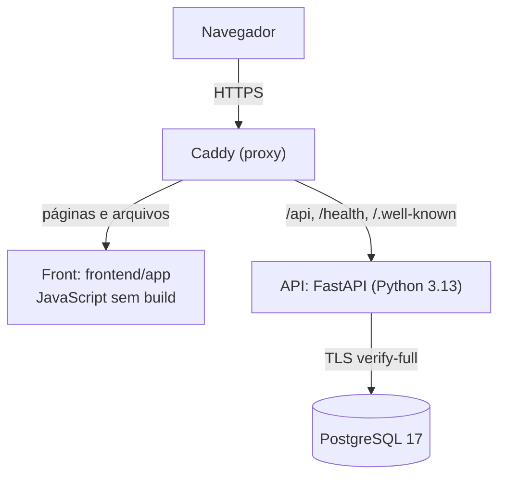
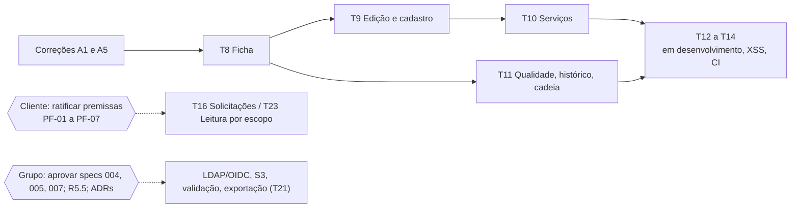

# Relatório geral de andamento · SGS Recife

- **Projeto:** SGS Recife, Plataforma de Governança de Dados de Saúde da Secretaria de Saúde do Recife.
- **Equipe:** Grupo 01, CESAR School (CS018).
- **Repositório oficial:** https://github.com/ViniciusVbm/sgs-api
- **Situação descrita:** `main` em `4a07f71`, de 10/11/2026. A auditoria documental foi feita no mesmo dia, na branch `docs/relatorio-implementacao`.
- **Documentos complementares:**
  - [Relatório de implementação](RELATORIO_IMPLEMENTACAO_SGS_RECIFE.md) ([PDF](RELATORIO_IMPLEMENTACAO_SGS_RECIFE.pdf)): o detalhe técnico do que existe;
  - [Guia de execução, uso e testes](GUIA_EXECUCAO_LOCAL_SGS_RECIFE.md) ([PDF](GUIA_EXECUCAO_LOCAL_SGS_RECIFE.pdf)): como rodar e testar.

> **Como ler este relatório.** Ele resume e liga os documentos existentes, sem repeti-los. Cada afirmação aponta para a fonte. Quando duas fontes divergem, a divergência fica registrada (§ 13). **"Implementado"** significa código com teste aprovado; **"integrado"**, que está na `main` do repositório oficial.

## 1. Apresentação do projeto
**O que é:**
- uma plataforma web para **centralizar, validar, controlar e visualizar** o cadastro da rede de saúde do Recife: unidades de saúde, equipamentos de saúde (policlínica, maternidade, base do SAMU, por exemplo) e serviços ofertados;
- cada alteração fica numa trilha de auditoria que não pode ser apagada (`steering/product.md`).

**O problema:**
- hoje esses dados vivem em planilhas espalhadas, sem regras de validação, sem controle de quem pode alterar o quê e sem histórico confiável;
- o cliente, a Secretaria de Saúde, pediu algo "modular", que possa crescer até a infraestrutura das unidades (salas, consultórios, situação).

**Escopo funcional do MVP** (`steering/product.md`):
- cadastro e consulta de unidades, equipamentos e serviços;
- validação automática;
- histórico de alterações;
- painel básico;
- autenticação com perfis.

**Fora do MVP:** integração real com o CNES, fluxo completo de aprovação, notificações, relatórios avançados, IA e outras integrações municipais.

**Contexto acadêmico** (`steering/product.md`, `docs/integration-audit/03-matriz-requisitos.md`). O projeto atende a várias disciplinas:

| Disciplina | Requisitos principais |
|---|---|
| Banco de Dados (etapas 1 a 6) | modelagem, SQL, consultas avançadas, views, funções, procedimentos, triggers, índices; entrega em 13/11/2026 |
| Projetos (Entrega 11) | testes, aceitação e documentação de resultados; validação em 21/11/2026 |
| Segurança e Auditoria (Gestão em Segurança da Informação) | fornecedores, riscos, ISO/IEC 38500, COBIT APO10, LGPD, trilha de auditoria |
| IAM | RBAC, autenticação, LDAP/OIDC, exportação para S3 |

**Prazos documentados:** validação em 21/11/2026, *code freeze* em 28/11/2026 e SR2 em 05/12/2026.

## 2. Histórico do desenvolvimento
O histórico Git da `main` tem 145 commits, em cinco ondas.

| Período | O que aconteceu | Estado | Fonte |
|---|---|---|---|
| 03/10/2026 | Fundação: specs, *steering*, esteira SDD com agentes (ADR-0006), projeto Python, `create_app`, erros, logs, `audit_log` imutável com hash encadeado (spec 001); specs 001 e 002 aprovadas | integrado | `git log`; `specs/001-fundacao` |
| 06 e 07/11/2026 | Desenvolvimento intenso na branch `feat/011-integracao`: RBAC (003), cadastro de unidades (006), recursos de banco da disciplina (011: views, triggers, procedimentos, partições, índices), ES256/JWKS. Uma branch por tarefa, com merge na de integração | integrado depois (na consolidação) | `git log` (107 commits nesses dois dias) |
| 09/11/2026 | **Auditoria das 15 branches e consolidação** numa `main` única, a partir da `feat/011-integracao`, com o conteúdo da `feat/003-interface-dashboard` reaproveitado e reescrito. Login com Argon2id e TOTP, CRUD completo, painel, histórico, seed de demonstração, documentação do banco e da governança. 885 testes aprovados | integrado; specs 008 a 010 implementadas **antes** da aprovação, por decisão registrada | `docs/integration-audit/`, `docs/RELATORIO_VALIDACAO_FINAL.md`, `docs/RESUMO_STATUS_PROJETO.md` |
| 09 e 10/11/2026 | Publicação no repositório oficial (`ViniciusVbm/sgs-api`). PR #1: regularização da governança (specs 008, 009 e 010 aprovadas; Vinicius dono de 003 a 005 e de 007 a 011). PR #2: testes dos filtros da trilha (008/T6). PR #3: revisão das pendências e das specs 004, 005, 007 e 010 | integrado (PRs #1 a #3) | `docs/RELATORIO_PR_PUBLICACAO.md`, `docs/relatorios/REGULARIZACAO_GOVERNANCA_SPECS.md`, `docs/relatorios/PENDENCIAS_EXTERNAS.md` |
| 10/11/2026 | **Spec 012 (frontend):** requisitos, design e tarefas aprovados (G1, G2, G3) e T1 a T7 implementadas, com o protótipo HTML virando a interface real integrada à API. Duas revisões por agente; o bloqueante do logout foi corrigido | integrado (PR #4, `4a07f71`) | `specs/012-frontend/`, PR #4 |

**Evolução da arquitetura:**
- **Início:** só a API, com o front num protótipo HTML fora do repositório, de dados no navegador.
- **Consolidação:** entraram o compose com TLS no banco e o proxy Caddy.
- **PR #4:** o Caddy passou a servir também o front, no mesmo domínio, com CSP (ADR-0010, Proposto).

**Preservação:**
- nenhuma branch foi apagada;
- as tags `arquivo/*` e um *bundle* guardam o histórico anterior (`docs/RESUMO_STATUS_PROJETO.md` § 1);
- as auditorias de integração ficam em `docs/integration-audit/` (11 documentos).

## 3. Arquitetura e tecnologias
O detalhe, com diagrama, está no [relatório de implementação](RELATORIO_IMPLEMENTACAO_SGS_RECIFE.md), §§ 2 e 3.

| Parte | Como é | Onde |
|---|---|---|
| Backend | Python 3.13, FastAPI 0.142, monólito modular (identidade, acesso, cadastro, painel, auditoria) e SQL explícito nos módulos da disciplina (ADR-0009, Proposto) | `src/` |
| Frontend | HTML, CSS e JavaScript em módulos nativos do navegador, sem framework nem build (ADR-0010, **Proposto**) | `frontend/app/` |
| Banco | PostgreSQL 17 com TLS obrigatório; 14 migrações Alembic; views, funções, procedimentos, triggers, partições, índices | `migrations/`, `docs/banco/` |
| Infraestrutura | Docker Compose com 4 serviços (`db-certs`, `db`, `api`, `proxy`) e Caddy 2 com HTTPS de CA local | `docker/` |
| Autenticação | senha Argon2id, 2FA por aplicativo (TOTP) obrigatório, token ES256 de 15 min só em memória no front, refresh rotativo em cookie protegido | `src/modules/identity`, `specs/002-autenticacao` |
| Autorização | RBAC: 7 papéis, 17 permissões, 4 escopos (global, área, distrito, unidade). A API decide; o front só reflete o `/me` | `src/modules/access`, `specs/003-rbac` |
| Contrato | OpenAPI 3.1 com 55 operações | `contracts/openapi.yaml`, `docs/api/endpoints.md` |
| Testes | pytest, testcontainers, Playwright em Python (ADR-0011, **Proposto**) | `tests/` |

**Termos usados:**
- **RBAC:** controle de acesso por papel.
- **Escopo:** até onde a permissão vale (rede, área, distrito ou unidade).
- **TOTP:** código de 6 dígitos que muda a cada 30 s.
- **CSP:** regra do navegador que só deixa rodar código do próprio site.
- **E2E:** testes de ponta a ponta, no navegador, contra o sistema real.

## 4. Funcionalidades
Fonte: [relatório de implementação](RELATORIO_IMPLEMENTACAO_SGS_RECIFE.md) § 4, conferido com o código e os testes.

| Módulo | Funcionando (com teste) | Parcial | Ainda não disponível |
|---|---|---|---|
| Acesso e sessão | login com usuário e senha; 2FA (cadastro com chave em texto, verificação); sessão mantida ao recarregar; renovação automática; sair (inclusive com token expirado); bloqueio depois de 5 erros; limite por IP | — | redefinição de senha e gestão de usuários pela interface (sem API: T22) |
| Perfis | menu e telas de acordo com as permissões dos 7 papéis; "sem acesso" quando a rota não é do papel | — | leitura restrita ao escopo (premissa do grupo, T23) |
| Painel (Início) | indicadores da API no escopo do papel (totais, pendências, sem CNES, alterações em 7 e 30 dias, distribuições), com barras que levam à lista filtrada | — | solicitações pendentes e regras mais violadas (R4.2) |
| Unidades | **API:** criar, consultar, alterar com controle de concorrência, desativar. **Front:** lista com busca, filtros, ordenação, paginação e filtros no endereço | o front ainda não tem ficha, cadastro nem edição ("Tela em implantação"; T8, T9) | campos extras (número, e-mail, horário, situações; T18) |
| Equipamentos e serviços | **API:** cadastro completo e vínculo com a unidade | o front ainda não tem a aba de serviços (T10) | "aparelhos" do protótipo, que são outro conceito (DF1, T15) |
| Auditoria | **API:** histórico por unidade, trilha geral com filtros, verificação da cadeia, log do banco | o front ainda não tem essas telas (T8, T11) | histórico geral no escopo do distrito (T20) |
| Banco (disciplina) | views, funções, procedimentos (um com CURSOR), triggers, partições, índices com prova de uso, SQL único de instalação, 8 consultas | 30 registros nos domínios fechados (decisão D1, a confirmar com o professor) | — |
| Demonstração | `sgs-admin seed demo`: 37 unidades, 31 equipamentos, 35 serviços e 30 usuários fictícios | — | conversor da planilha do cliente (010/T3) |
| Integrações | — | o banco já tem colunas para usuários externos | LDAP/OIDC (004), S3 (005), validação configurável (007), solicitações, notificações, importação e exportação |

**O que o front mostra hoje sem ser funcionalidade:**
- **"Tela em implantação":** a funcionalidade tem tarefa prevista e a API já existe.
- **"em desenvolvimento":** não há backend.

Nenhuma das duas simula dados.

## 5. Perfis e permissões
São 7 papéis, cada um com um usuário de demonstração em `seeds/demo/usuarios.json` (§ 9). O comportamento real da API está no [relatório de implementação](RELATORIO_IMPLEMENTACAO_SGS_RECIFE.md) § 5.

| Papel | Responsabilidade (arquitetura conceitual) | O que a API permite hoje | Usuário de demonstração |
|---|---|---|---|
| Gestor de Dados | governança central | tudo no cadastro, painel e trilha, em toda a rede | `demo.carla.dias` |
| Coordenador Técnico | área técnica central (ex.: Saúde Mental) | escrever na sua área; painel e histórico da área | `demo.gabriela.reis` |
| Técnico Distrital | o próprio distrito sanitário | alterar unidades, equipamentos e serviços do distrito | `demo.nicolas.brito` (DS IV) |
| Gestor de Unidade | a própria unidade | alterar a própria unidade | `demo.sofia.barros` (CAPS II) |
| Diretoria | leitura e painel | só leitura | `demo.yara.duarte` |
| Auditor | trilha e eventos de acesso | só leitura; verificar a cadeia | `demo.bento.sa` |
| Administrador de TI | papéis e usuários | atribuir papéis; não lê o cadastro | `demo.ana.lima` |

**Regras documentadas que divergem do comportamento atual** (nenhuma delas é defeito; são decisões pendentes):
- **Leitura de unidades:** é **global** para todos os papéis de negócio. As premissas do grupo (Grupo-DF2) pedem leitura limitada ao escopo.
- **Escrita direta:** o Técnico Distrital, o Gestor de Unidade e o Coordenador **podem** gravar direto pela API no seu escopo. O front **esconde** essa escrita até a decisão (spec 012, R7.4), e esconder botão não é controle de segurança.
- **Campos estruturais:** a API protege distrito, tipo e CNES (403 `campos_estruturais`), mas **não** o status. As premissas (Grupo-DF14) tratam o status como sensível.

## 6. Requisitos e especificações
São 12 specs, no fluxo SDD: requisitos (G1), depois design (G2), depois tarefas (G3) e só então implementação. Fonte: `specs/*/tasks.md` e `specs/README.md`, conferidos em 10/11/2026.

| Spec | Assunto | Situação | Tarefas | Abertas |
|---|---|---|---|---|
| 001 | Fundação | Aprovada | 9 de 9 | — |
| 002 | Autenticação | Aprovada | 8 de 8 | — |
| 003 | RBAC | Aprovada (+ emenda) | 7 de 8 | T8: mapeamento grupo→papel (depende da 004) |
| 004 | LDAP e OIDC | **Rascunho** | 0 de 9 | todas |
| 005 | Exportação para S3 | **Rascunho** | 0 de 8 | todas; R5 (assinatura) sem design |
| 006 | Cadastro de unidades | Aprovada | 9 de 10 | T10: desempenho da busca |
| 007 | Validação de dados | **Rascunho** | 0 de 6 | todas |
| 008 | Histórico e auditoria | Aprovada | 5 de 5 | — |
| 009 | Painel | Aprovada | 2 de 4 | T2b (cache, se a T3 pedir), T3 (desempenho) |
| 010 | Dados de demonstração | Aprovada | 2 de 3 | T3: conversor da planilha (depende do cliente) |
| 011 | Recursos de banco | Aprovada | 22 de 22 | — |
| 012 | Frontend | Aprovada (G1, G2, G3) | 7 de 23 | T8 a T14 (escopo mínimo) e T15 a T23 (bloqueadas) |

**Spec 012 em detalhe:**
- tem 57 requisitos aprovados (44 do escopo mínimo, 13 do completo) e 1 proposto, o R5.5;
- a matriz de cada requisito, com como testar, está no [guia](GUIA_EXECUCAO_LOCAL_SGS_RECIFE.md) § 5;
- os requisitos atendidos são os de entrega, aparência, autenticação, perfis, início, lista e segurança da interface;
- o R1.5 (acessibilidade do modal) é parcial;
- ficha, edição, serviços, qualidade e histórico estão pendentes.

**Dependências principais:**
- **Specs 004, 005 e 007:** cobrem requisitos obrigatórios das disciplinas e estão em Rascunho. Nada pode ser implementado antes da aprovação (`AGENTS.md`, regra 1).
- **003/T8:** depende da 004/T1.
- **Escopo completo da 012 (T15 a T23):** depende das decisões e das specs da § 10.

## 7. Decisões e governança
**Regras:**
- requisitos e tarefas são aprovados pelo dono da spec;
- o design, pelo dono e mais um integrante;
- o agente de código **nunca** marca uma spec como aprovada (`steering/sdd-workflow.md`).

**Responsáveis registrados:**
- **Vinicius** é dono das specs 003 a 005 e 007 a 012 desde 09/11/2026;
- **Hélder** é responsável pela 006, por decisão do Grupo 01 de 10/11/2026; a formalização na própria spec está pendente;
- as aprovações anteriores do **Rafael** ficam com o nome dele.

### 7.1 Gates da spec 012
| Gate | Situação | Origem do registro |
|---|---|---|
| G1 (requisitos) | Aprovado (Vinicius, 09/11/2026). Emenda documental 1 aprovada em 10/11/2026 | status escrito no arquivo; o dono confirmou no PR #4 (comentário de 10/11/2026, 18:06) |
| G2 (design) | Aprovado (Vinicius, Igor Fugagnoli e Erick Sanches, 10/11/2026) | a aprovação de Igor e Erick foi **comunicada pelo dono**; **não há review deles no GitHub** (`design.md` § Registro de aprovação). O dono confirmou no PR #4 |
| G3 (tarefas) | Aprovado (Vinicius, 10/11/2026) | idem |
| Exceção da T1 | T1 implementada antes do G2, por exceção pontual do dono | `steering/sdd-workflow.md` |
| Revisão do PR #4 | duas revisões por agente: a 1ª **bloqueou** (logout, aprovações); a 2ª confirmou a correção | comentários no PR #4 |

### 7.2 Decisões do Grupo 01 (10/11/2026)
A numeração do documento do grupo **não é** a da spec 012. Por isso o prefixo **Grupo-** (`specs/012-frontend/requirements.md` § Decisões).

| Registro | Tipo | Conteúdo | Situação |
|---|---|---|---|
| Grupo-DF9 | decisão interna | histórico só leitura, por unidade e geral, paginado, no escopo | **aprovada pelo grupo**. A API já atende, exceto o nome `/api/v1/historico` (a rota existente é `/auditoria/eventos`) e o histórico geral no distrito |
| Grupo-DF15 | decisão interna | exportação pelo backend, CSV e PDF, auditada, no escopo | **aprovada pelo grupo**; não implementada. Faltam a spec do backend, as colunas e o layout (PF-06). Gerou o R5.5, **proposto** |
| Grupo-DF2 | premissa | leitura e ações limitadas ao escopo do perfil | **adotada pelo grupo; aguarda ratificação do cliente** |
| Grupo-DF13 | premissa | propor e aprovar por perfil (central, coordenador do DS, gerente) | idem |
| Grupo-DF14 | premissa | campos comuns diretos; campos sensíveis com aprovação central | idem |

**Decisões do dono da spec 012** (09/11/2026):
- DF6: 2FA em texto, sem QR Code;
- DF7: rótulo "Usuário";
- DF8: telas para os 7 papéis;
- DF10: exportação pelo backend;
- DF11: Playwright em Python;
- DF12: escopo mínimo de 21/11.

**Decisões pendentes:** DF1, DF3, DF4 e DF5 (cliente), DF9 (eventos de acesso para o Gestor de Dados), DF13 e DF14 da spec, e a permissão de exportação (DF15).

### 7.3 Perguntas P1 a P5 e pendências formais
As perguntas que as premissas deixaram abertas viraram as **PF-01 a PF-07**, com responsável, prazo e solução provisória (`requirements.md` § Pendências formais).

**O que já foi resolvido tecnicamente:**
- o "Coordenador do DS" corresponde ao `TECNICO_DISTRITAL`;
- a interface não oferece "aprovar" enquanto a API não tiver esse fluxo.

**Continuam sem resposta:**
| Pendência | Pergunta |
|---|---|
| PF-01 | o distrito e a unidade editam direto ou propõem? |
| PF-02 | o coordenador do DS aprova? |
| PF-03 | qual é a regra do `COORD_TECNICO`? |
| PF-04 | o que é o "vínculo da unidade"? |
| PF-05 | como se classificam bairro, gestor e coordenadas? |
| PF-06 | quais são as colunas do CSV e o layout do PDF? |
| PF-07 | o cliente ratifica as premissas? |

### 7.4 ADRs
| Situação | ADRs |
|---|---|
| **Aceitos** | 0007 (dependências complementares), 0008 (merge pelo administrador com CI) |
| **Propostos** | 0001 (FastAPI), 0002 (monólito modular), 0003 (identidade federada), 0004 (RBAC próprio), 0005 (S3), 0006 (SDD), 0009 (SQL explícito), **0010 (front em módulos ES)** e **0011 (Playwright)** |

Os ADRs 0010 e 0011 já são aplicados pela entrega, mas **não foram aceitos formalmente pelo grupo**.

## 8. Testes e qualidade
**Conjuntos de testes:**
- unidade (`tests/unit`);
- integração com PostgreSQL descartável (`tests/integration`);
- arquitetura e regras do front (`tests/architecture`);
- ponta a ponta com o compose (`tests/e2e`) e no navegador (`tests/e2e_front`).

Detalhes no [guia](GUIA_EXECUCAO_LOCAL_SGS_RECIFE.md) § 4.

| Verificação | Resultado | Quando | Situação |
|---|---|---|---|
| `make check` (lint, formatação, tipos, arquitetura e testes rápidos) | **979 aprovados, 3 pulados (justificados), 0 falhas** | 10/11/2026, clone novo | aprovado |
| Testes lentos de infraestrutura (TLS, entrega, índices) | **12 aprovados** | 10/11/2026 | aprovado |
| E2E do front | **45 aprovados** | 10/11/2026 | aprovado |
| Todos os lentos de uma vez (`make test-all`) | 56 aprovados e **1 erro** (`test_indices.py`) | 10/11/2026 | **falha conhecida (A5)** |
| Roteiro manual do guia (repetido por script) | **17 de 17** passos; dados preservados ao parar e subir | 10/11/2026 | aprovado |
| CI do GitHub (`quality`, `compose-smoke`) | verdes no merge do PR #4 e nos PRs #1 a #3 | 10/11/2026 | aprovado |
| E2E no CI | os E2E **não rodam no CI** (T14) | — | não realizado |
| Bloqueio por 5 senhas erradas, manual | coberto por teste automatizado | — | não realizado manualmente |

**Problemas conhecidos** (relatório de implementação, § 10):
| Código | Problema | Efeito |
|---|---|---|
| A1 | o Swagger (`/docs`) não abre pelo proxy desde a T1 (cai no front) | contorno no guia, § 1.6 |
| A2 | rodar o `seed demo` de novo mostra uma senha que não se aplica | o guia alerta |
| A3 | o nome do projeto no compose é fixo (`sgs-api`) | documentado (use `-p`) |
| A4 | o redirecionamento HTTP ignora a porta alternativa | documentado |
| A5 | o `make test-all` tem 1 erro, por interferência dos E2E do front | rodar os conjuntos separados |

**Ressalva:** testes aprovados mostram que os comportamentos verificados funcionam; **não garantem** a ausência de defeitos. Os achados A1, A2 e A5 foram encontrados justamente depois de testes verdes.

## 9. Como executar, utilizar e testar
O passo a passo completo está no **Guia de execução, uso e testes**: [Markdown](GUIA_EXECUCAO_LOCAL_SGS_RECIFE.md) ou [PDF](GUIA_EXECUCAO_LOCAL_SGS_RECIFE.pdf).

1. **Instalar:** Git, Docker com Compose v2 e uv (guia § 1.1).
2. **Iniciar:** são 8 comandos (guia, "Caminho rápido"). Não é preciso `.env`. Com as portas 80 e 443 ocupadas, siga o guia § 1.5.
3. **Acessar:**
   - abra https://localhost e aceite o certificado local;
   - os usuários de demonstração são os da § 5 (guia § 2.1), com a senha definida no `seed demo`;
   - o 2FA é cadastrado no primeiro acesso, pelo celular ou pelo terminal (guia § 2.3).
4. **Testar à mão:** 22 passos com o resultado esperado (guia § 3).
5. **Testes automatizados:** `make check`, e depois os lentos separados (guia § 4).
6. **Parar sem perder dados:** `docker compose -f docker/compose.yml down`. **`down -v` apaga o banco.**

## 10. Pendências e próximos passos
Sem prazos ou responsáveis além dos documentados.

### Prioridade alta (bloqueios funcionais, técnicos ou de integração)
| O que falta | Por quê | Spec/tarefa | Depende de | Concluído quando |
|---|---|---|---|---|
| Corrigir o A5 (`make test-all` com 1 erro) | a suíte completa precisa ficar verde | 012/T14 | — | `make test-all` sem erro |
| Corrigir o A1 (Swagger pelo proxy) | o README e o guia prometem `/docs`; regressão da T1 | 012/T1 (correção) | — | `/docs` e `/openapi.json` respondem pela API, com teste em `test_frontend_entrega.py` |
| Telas T8 a T11 (ficha, edição e cadastro, serviços, qualidade, histórico e cadeia) | escopo mínimo da validação de 21/11 | 012/T8 a T11 | só os gates (já aprovados); as APIs existem | testes de cada tarefa aprovados |
| Ratificação das premissas pelo cliente | define edição, aprovação, leitura e exportação | PF-07 (e PF-01 a PF-05) | o cliente | decisão registrada na spec 012 |
| Aprovar as specs 004 (LDAP/OIDC), 005 (S3) e 007 (validação) | requisitos obrigatórios das disciplinas; nada pode ser implementado antes | 004, 005, 007 | o dono, mais um integrante no design | status `Aprovado` nos três arquivos |

### Prioridade média
| O que falta | Por quê | Spec/tarefa | Depende de | Concluído quando |
|---|---|---|---|---|
| T12 a T14 (telas "em desenvolvimento" completas, XSS e responsividade, E2E no CI, documentação) | fechar o escopo mínimo | 012/T12 a T14 | T8 a T11 | testes aprovados; E2E rodando no CI |
| Tela de papéis do Admin TI | a API existe, mas nenhuma tarefa cobre a tela (achado R2 da revisão do PR #4) | 012 (criar a tarefa) | dono da 012 | tarefa criada e testada |
| Prova do R1.5 (acessibilidade do modal) | requisito citado sem teste | 012/T9, T13 | primeiro modal real | teste de foco e `aria-live` |
| Corrigir o A2 (senha do seed) | evita confusão na demonstração | 010 | — | o seed só mostra a senha se criar usuários |
| Aceitar os ADRs 0010 e 0011 | já são aplicados | ADR | o grupo | status `Aceito` |
| Aprovar ou recusar o R5.5 (exportação em PDF e do resumo) | é uma decisão do grupo, ainda proposta | 012 | o dono | G1 da emenda funcional |
| Formalizar o Hélder como responsável pela 006 | decisão do grupo ainda não registrada na spec | 006 | o Hélder | linha "Dono humano" na 006 |
| Desempenho da busca e do painel | requisito de 1 s com 1.000 unidades sem medição | 006/T10, 009/T3 | — | teste de desempenho |

### Prioridade baixa (futuro, dependente de decisões)
| O que falta | Spec/tarefa | Depende de |
|---|---|---|
| Solicitações e aprovação | 012/T16 | PF-01 a PF-05, PF-07; spec de solicitações; emenda da 003 |
| Leitura por escopo | 012/T23 | PF-07 (Grupo-DF2); emenda da 003 |
| Exportação e importação | 012/T21 | spec do backend; PF-06; R5.5 |
| Histórico do distrito, eventos de acesso | 012/T20 | emenda da 008; DF9 |
| Campos e situações da unidade; observação | 012/T18 | DF3; emenda da 006 |
| Revisão de ficha e filtros de qualidade | 012/T19 | spec 007; emenda da 006 |
| Aparelhos (infraestrutura) | 012/T15 | DF1; spec nova |
| Notificações | 012/T17 | spec nova |
| Senha e usuários pelo Admin TI | 012/T22 | spec da 003 para `/admin/usuarios` |
| Mapeamento grupo→papel | 003/T8 | 004/T1 |
| Conversor da planilha | 010/T3 | planilha do cliente |
| Itens acadêmicos a confirmar com o professor | — | 30 tuplas nos domínios fechados (decisão D1) |

## 11. Roadmap sugerido
**É uma sugestão de ordem, não uma decisão aprovada.**

1. **Agora, sem depender de ninguém:**
   - corrigir o A5 e o A1 (pequenos, com teste);
   - depois, T8 → T9 → T10 e T11, em paralelo com a T10;
   - por fim, T12 a T14. A meta é o escopo mínimo da validação de 21/11/2026.
2. **Em paralelo, decisões do grupo:**
   - aprovar as specs 004, 005 e 007;
   - decidir o R5.5;
   - aceitar os ADRs 0010 e 0011;
   - criar a tarefa da tela de papéis;
   - formalizar a 006.
3. **Depende do cliente:** a ratificação das premissas, que libera as T16 e T23, e os itens DF1, DF3 a DF5, além da planilha (010/T3).
4. **Depois das specs aprovadas:** LDAP/OIDC (004 → 003/T8), S3 e exportação (005, T21), validação (007 → T19).

## 12. Conclusão
**Situação geral:**
- o backend do MVP está **implementado, testado e integrado**: autenticação forte, RBAC com escopo, cadastro, painel, auditoria e recursos de banco da disciplina;
- a interface web **começou a ser integrada**, com login, perfis, Início e lista funcionando contra a API real;
- a qualidade é verificada por cerca de 1.000 testes automatizados e pelo CI.

**Principais entregas:**
- consolidação de 15 branches numa `main` única, com o histórico preservado;
- publicação no repositório oficial e regularização da governança;
- 979 testes rápidos aprovados;
- primeira entrega do front (T1 a T7) com 45 E2E aprovados;
- guia de execução validado num clone novo.

**Principais limitações:**
- as telas de ficha, edição, serviços, qualidade e histórico ainda não existem no front;
- LDAP/OIDC, S3 e validação configurável (requisitos obrigatórios das disciplinas) estão só em spec, em Rascunho;
- as premissas de permissão aguardam o cliente;
- há 5 problemas conhecidos, sendo A1 e A5 os principais a corrigir;
- os E2E ainda não rodam no CI.

**Próximo objetivo recomendado:**
- **técnico:** corrigir A1 e A5 e entregar as T8 a T11, que só dependem de trabalho da equipe, porque as APIs já existem;
- **de governança:** levar as specs 004, 005 e 007 à aprovação e obter a ratificação do cliente.

## 13. Divergências encontradas entre documentos (10/11/2026)
| Documento | O que diz | Situação real | Fonte da situação real |
|---|---|---|---|
| `docs/RESUMO_STATUS_PROJETO.md` (09/11) | o front "não está neste repositório" e "falta integrar" | front integrado (T1 a T7) desde o PR #4 | `git log` (`4a07f71`); `specs/012-frontend/tasks.md` |
| `specs/README.md`, linha da 012 | a emenda documental 1 "aguarda o dono" | aprovada em 10/11/2026 e confirmada pelo dono no PR #4 | `specs/012-frontend/requirements.md` (Status); comentário no PR #4 |
| `README.md`, "Comece por aqui" | ADRs "0001 a 0009" e specs "001 a 011" | existem o ADR-0010, o ADR-0011 e a spec 012; **corrigido nesta branch** | `docs/adr/`, `specs/` |
| `README.md` (antes desta branch) | Swagger em `https://localhost/docs` | não abre pelo proxy (A1) | verificação de 10/11/2026; já corrigido nesta branch |
| `docs/instalacao.md` | comandos com as portas padrão, sem `-p` | válidos; não cobrem portas ocupadas nem outro ambiente | guia § 1.5 |

Os documentos de 09/11 são registros datados. Esta branch não os reescreve: só aponta a divergência.

## Referências
- **Visão geral e regras:** `steering/product.md`, `steering/tech.md`, `steering/sdd-workflow.md`, `AGENTS.md`.
- **Este conjunto de documentos:** [relatório de implementação](RELATORIO_IMPLEMENTACAO_SGS_RECIFE.md), [guia de execução, uso e testes](GUIA_EXECUCAO_LOCAL_SGS_RECIFE.md).
- **Histórico:** `docs/integration-audit/`, `docs/RELATORIO_VALIDACAO_FINAL.md`, `docs/RESUMO_STATUS_PROJETO.md`, `docs/RELATORIO_PR_PUBLICACAO.md`.
- **Requisitos e evidências:** `docs/REQUISITOS_EVIDENCIAS.md`, `specs/`, `specs/README.md`.
- **Governança e pendências:** `docs/relatorios/REGULARIZACAO_GOVERNANCA_SPECS.md`, `docs/relatorios/PENDENCIAS_EXTERNAS.md`, `docs/governanca/`.
- **Frontend:** `specs/012-frontend/`, `docs/frontend-integracao.md`, `docs/PLANO_INTEGRACAO_FRONTEND.md`.
- **Arquitetura:** `docs/architecture/`, `docs/adr/`, `contracts/openapi.yaml`, `docs/api/`.
- **Banco:** `docs/banco/`.
