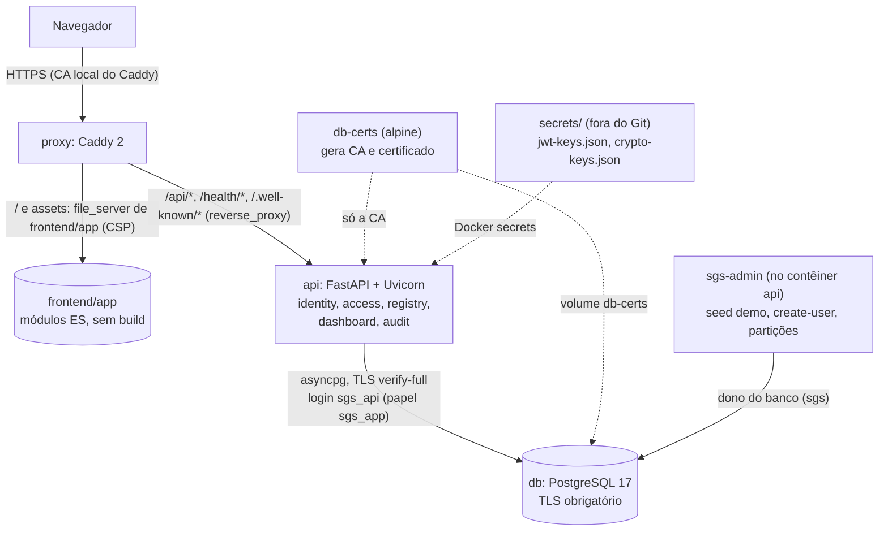

# Relatório técnico de implementação · SGS Recife

- **Versão auditada:** `main` em `4a07f71`, com o PR #4 integrado em 10/11/2026. Repositório: https://github.com/ViniciusVbm/sgs-api
- **Data da auditoria:** 10/11/2026. Foi feita contra o código, o contrato, as migrações, o compose e os testes. Os documentos antigos só foram usados como referência cruzada.
- **Para executar:** [GUIA_EXECUCAO_LOCAL_SGS_RECIFE.md](GUIA_EXECUCAO_LOCAL_SGS_RECIFE.md).
- **Classificação usada:**
  - **Implementada e testada:** há código e teste que a provam contra a API real.
  - **Parcial:** funciona em parte, com a lacuna indicada.
  - **Prevista:** tem tarefa, mas ainda não tem código.
  - **Bloqueada por backend:** não existe rota ou campo na API.
  - **Pendente de decisão externa:** depende do cliente ou do grupo.

## 1. Visão geral
**O que é:** a Plataforma de Governança de Dados de Saúde da Secretaria de Saúde do Recife, projeto do Grupo 01 (CESAR School, CS018) com cliente real.

**O problema que resolve:** o cadastro de unidades de saúde, equipamentos e serviços vive hoje em planilhas espalhadas. O sistema o reúne em um lugar, com validação, controle de acesso por papel e escopo, e trilha de auditoria imutável.

**Para quem:** sete papéis (§ 5), do nível central da Secretaria à gerência de cada unidade, além de diretoria, auditoria e TI.

**Estado atual:**
- **Backend:** o MVP está **implementado e testado**:
  - autenticação com 2FA;
  - RBAC com escopo;
  - cadastro de unidades, equipamentos, serviços e referências;
  - painel e consultas de qualidade;
  - trilha de auditoria e log do banco;
  - recursos de banco da disciplina.
- **Frontend:** a **primeira entrega** está integrada (spec 012, T1 a T7): login com 2FA, sessão, navegação por permissão, Início e lista de unidades. As demais telas estão previstas (T8 a T14) ou dependem de backend e de decisões (T15 a T23).
- **Fora do repositório por ora:** LDAP/OIDC (spec 004), exportação para S3 (spec 005) e validação configurável (spec 007), todas em Rascunho.

## 2. Arquitetura
Um monólito modular em Python (FastAPI), com SQL explícito nos módulos cobrados pela disciplina de Banco de Dados (ADR-0009, Proposto), atrás de um proxy Caddy que também serve o front estático (ADR-0010, Proposto).



- **Frontend** (`frontend/app/`):
  - HTML, CSS e JavaScript em módulos ES nativos, sem framework, sem npm e sem build;
  - o access token fica só em memória; o refresh é um cookie `HttpOnly; Secure; SameSite=Strict` com `Path=/api/v1/auth`;
  - o menu é derivado das permissões do `GET /api/v1/me`, e a autorização efetiva é sempre da API.
- **Backend** (`src/`):
  - **Módulos:** `identity` (login, 2FA, sessões, JWT), `access` (RBAC, `/me`, atribuições), `registry` (unidades, equipamentos, serviços, referências), `dashboard` (resumo, consultas, inventário) e `audit` (trilha, verificação, log do banco).
  - **Camadas** `api`, `application`, `domain` e `infrastructure`, verificadas por 6 contratos do import-linter.
- **Banco:**
  - PostgreSQL 17 com TLS obrigatório; 14 revisões Alembic (até a `0011_09`);
  - a API conecta como `sgs_api` (papel `sgs_app`, sem UPDATE ou DELETE em `audit_log`), e as migrações rodam como dono;
  - objetos da disciplina: views, funções, procedimentos (um com CURSOR), triggers, partições e índices (`docs/banco/`).
- **Autenticação:**
  - senhas em Argon2id; TOTP obrigatório; access JWT ES256 de 15 minutos, com JWKS público;
  - refresh opaco rotativo, com detecção de reuso;
  - anti-CSRF no refresh (`X-Requested-With: sgs` e `Origin` em `CORS_ORIGINS`);
  - limite de 10 logins por minuto por IP, e bloqueio por 15 minutos depois de 5 falhas.
- **Autorização:** RBAC com 7 papéis e 17 permissões, em 4 níveis de escopo (global, área, distrito, unidade), resolvidos no servidor a cada requisição. A matriz está em `docs/architecture/arquitetura-conceitual.md` § 4.
- **Contrato:** `contracts/openapi.yaml` (OpenAPI 3.1, em JSON), com 55 operações, regenerado por `make openapi` e conferido no CI.
- **Docker:** `docker/compose.yml` sobe `db-certs`, `db`, `api` e `proxy`. O `secrets/` é montado como Docker secret. O compose **não** lê o `.env`.

**Integrações ainda não existentes:** LDAP e OIDC (004), S3 (005), notificações, solicitações e aprovação, importação e exportação.

## 3. Tecnologias
Versões tiradas de `pyproject.toml`, `uv.lock`, `docker/compose.yml` e `docker/Dockerfile`.

| Camada | Tecnologia | Responsabilidade | Estado |
|---|---|---|---|
| Linguagem | Python 3.13 (`.python-version`) | API e ferramentas | em uso |
| API | FastAPI 0.142, Pydantic 2.13, Uvicorn 0.54 | rotas, validação, servidor | em uso |
| Banco | PostgreSQL 17, SQLAlchemy 2.1 (Core/`text`), asyncpg 0.31, Alembic 1.20 | dados, SQL explícito, migrações | em uso |
| Segurança | PyJWT 2.15 (ES256), pwdlib[argon2] 0.3, pyotp 2.10, cryptography 50 (AES-256-GCM), limits 5.8 | tokens, senhas, TOTP, cifra de campo, rate limit | em uso |
| Logs | structlog 26 | JSON com redação de segredos | em uso |
| Proxy | Caddy 2 | HTTPS, front estático, CSP, reverse proxy | em uso |
| Front | HTML, CSS e JavaScript (módulos ES nativos), Atkinson Hyperlegible local (SIL OFL) | interface | em uso (ADR-0010, **Proposto**) |
| Testes | pytest 9, testcontainers 4.15, hypothesis 6, Playwright 1.65 (Python) | unidade, integração, E2E | em uso (Playwright: ADR-0011, **Proposto**) |
| Qualidade | ruff 0.16, mypy 2.4 (strict), import-linter 2.15, bandit 1.9, pip-audit 2.10 | lint, tipos, arquitetura, segurança | em uso (`make check` e CI) |
| Build | uv (0.11.28 na imagem), Docker 26+ com Compose v2 | dependências e contêineres | em uso |
| CI | GitHub Actions: `quality` e `compose-smoke` | verificação de todo PR | em uso |

## 4. Funcionalidades
### 4.1 Backend (API)
O backend tem a rastreabilidade detalhada em [REQUISITOS_EVIDENCIAS.md](REQUISITOS_EVIDENCIAS.md) e o catálogo de rotas em [api/endpoints.md](api/endpoints.md). Aqui fica o resumo.

| Funcionalidade | Rotas (`/api/v1`) | Permissão | Estado | Testes (exemplos) |
|---|---|---|---|---|
| Login, 2FA, refresh, logout | `auth/login`, `auth/mfa/{enroll,confirm,verify}`, `auth/refresh`, `auth/logout` | pública ou sessão | implementada e testada | `tests/integration/identity/*` |
| Perfil e permissões efetivas | `me` | autenticado | implementada e testada | `integration/access/test_me.py` |
| Papéis e atribuições | `admin/papeis`, `admin/atribuicoes[/{id}]` | `papel:assign` | implementada e testada | `integration/access/test_admin_atribuicoes.py` |
| Unidades: listar (filtros, paginação), detalhar, criar, alterar (If-Match), desativar (procedure) | `unidades`, `unidades/{id}`, `unidades/{id}/desativar` | `unidade:*` com escopo | implementada e testada | `integration/registry/test_crud_unidades.py` |
| Equipamentos e serviços (na unidade e soltos) | `unidades/{id}/equipamentos`, `equipamentos`, `unidades/{id}/servicos`, `servicos` | `equipamento:write`, `servico:write` | implementada e testada | `integration/registry/test_crud_vinculos.py` |
| Referências (distritos, áreas, tipos) | `referencias/{tipo}` | leitura: `unidade:read`; escrita: central | implementada e testada | `test_crud_vinculos.py` |
| Painel: resumo, 8 consultas, catálogo, inventário (view) | `dashboard/resumo`, `dashboard/consultas/*`, `dashboard/inventario` | `dashboard:read` no escopo | implementada e testada | `integration/dashboard/test_painel.py`, `test_consultas_qualidade.py` |
| Histórico da unidade e trilha geral (filtros de período, autor, entidade) | `unidades/{id}/historico`, `auditoria/eventos[/{id}]` | `auditoria:read` (geral: escopo global) | implementada e testada | `integration/audit/test_consulta_trilha.py` |
| Verificação da cadeia de hash | `auditoria/verificar` | `auditoria:read` global | implementada e testada | `test_consulta_trilha.py` |
| Log do banco e partições | `auditoria/banco`, `auditoria/banco/particoes` | auditoria | implementada e testada | `integration/audit/test_log_banco.py` |
| Administração por CLI | `sgs-admin seed demo`, `create-user`, `banco particoes` | contêiner | implementada e testada | `integration/tools/*` |

### 4.2 Frontend (spec 012)
| Funcionalidade | Onde | API usada | Estado | Prova |
|---|---|---|---|---|
| Entrega no mesmo domínio, CSP, proxy | `docker/caddy/Caddyfile`, `frontend/app/index.html` | — | implementada e testada (T1) | `tests/e2e/test_frontend_entrega.py` |
| Aparência do protótipo, fonte e ícones locais | `frontend/app/assets/` | — | implementada e testada (T2) | `tests/e2e_front/test_aparencia.py` |
| Escape de HTML, roteador, modal, avisos, estados (carregando, vazio, erro) | `js/html.js`, `js/router.js`, `js/ui/` | — | implementada e testada (T3). O foco preso do modal ainda não tem tela nem teste (R1.5) | `tests/architecture/test_frontend_estatico.py`, `test_estados.py` |
| Login, cadastro e verificação do 2FA, refresh, 401 → refresh, sair (inclusive com token expirado) | `js/auth.js`, `js/api.js`, `js/views/login.js` | `auth/*` | implementada e testada (T4) | `test_autenticacao.py` (11) |
| Menu e telas por permissão, "sem acesso", início por papel | `js/perms.js`, `js/shell.js`, `js/main.js` | `me` | implementada e testada (T5) | `test_perfis.py` (18) |
| Início com os indicadores | `js/views/inicio.js` | `dashboard/resumo` | implementada e testada (T6). Solicitações pendentes e "fichas com mais pendências" estão em desenvolvimento (R4.2) | `test_inicio.py` |
| Lista: busca, filtros, ordenação, paginação, filtros na URL, recorte do DS | `js/views/unidades.js`, `js/referencias.js` | `unidades`, `referencias/{tipo}` | implementada e testada (T7) | `test_lista.py` |
| Ficha da unidade, histórico da ficha, verificações | rota `#/unidade/{id}` | `unidades/{id}`, `/historico` (existem) | **prevista (T8)**: a tela mostra "Tela em implantação" | — |
| Edição e cadastro central (diff, If-Match) | rota `#/nova` | `PATCH`/`POST unidades` (existem) | **prevista (T9)** | — |
| Serviços da unidade | — | `unidades/{id}/servicos` (existe) | **prevista (T10)** | — |
| Qualidade, histórico geral, verificação da cadeia | `#/qualidade`, `#/historico`, `#/cadeia` | existem | **prevista (T11)** | — |
| Papéis e atribuições (Admin TI) | `#/papeis` | existe | **prevista**, ainda sem tarefa (achado R2 da revisão do PR #4) | — |
| Solicitações e validações, notificações, importação, exportação CSV/PDF, usuários | menus marcados "em desenvolvimento" | **não existem** | **bloqueada por backend ou por decisão** (T15 a T23) | presença visível em `test_perfis.py` |

**O que não é integração real:** alguns casos de teste forçam a resposta da API para exercitar o tratamento do front: 429, login sem 2FA em dev, resposta lenta, erro 500 e 401 no logout. Todo o resto roda contra a API real com o `seed demo`.

## 5. Perfis e permissões (comportamento real da API)
A matriz é a da `0003_access` com o ajuste da `0011_09` (`dashboard:read` por escopo). Fonte: `tests/integration/access/test_seed_matriz.py`. Em todos os papéis de negócio, a leitura de unidades é **global**.

| Papel | Escopo de escrita e de painel | Pode fazer (API) | Telas hoje (front) | Restrições e limitações |
|---|---|---|---|---|
| `GESTOR_DADOS` | global | ler, criar, alterar e desativar unidades; equipamentos e serviços; referências; painel; trilha; exportar (sem rota) | Início, Unidades; Cadastrar, Qualidade e Histórico em implantação; Validações e Importar em desenvolvimento | — |
| `COORD_TECNICO` | área técnica | criar e alterar unidades, equipamentos e serviços na área; painel e histórico na área | Início, Unidades; Validações em desenvolvimento; Qualidade em implantação | a escrita direta está **oculta** na interface (R7.4, PF-03) |
| `TECNICO_DISTRITAL` | distrito | alterar unidades, equipamentos e serviços no DS; painel e histórico no DS | Início e Unidades (abre no DS); Solicitar e Solicitações em desenvolvimento | escrita oculta (R7.4, PF-01); o histórico geral do DS não existe na API |
| `GESTOR_UNIDADE` | unidade | alterar a própria unidade; painel e histórico dela | Minha unidade (em implantação), Minhas solicitações | escrita oculta (R7.4, PF-01) |
| `DIRETORIA` | global (leitura) | ler; painel | Início, Unidades, Qualidade | não altera dados; sem histórico |
| `AUDITOR` | global (leitura) | ler; trilha e eventos de acesso; verificar a cadeia | Unidades; Histórico geral e Verificação da cadeia em implantação | sem painel |
| `ADMIN_TI` | global | atribuir e remover papéis; gerenciar usuários (sem rota) | Papéis e atribuições (em implantação); Usuários em desenvolvimento | não lê cadastro (segregação de funções) |

**Diferenças em relação às premissas do Grupo 01** (aguardam a ratificação do cliente; `specs/012-frontend/requirements.md` § Decisões):
- **Grupo-DF2 (leitura limitada ao escopo):** hoje a leitura é global. Restringir exige emenda da 003 e migração (T23).
- **Grupo-DF13 (propor e aprovar por perfil):** não há fluxo de solicitação na API. Hoje o `alteracao:validar` é só do Gestor de Dados e do Coordenador Técnico.
- **Grupo-DF14 (campos comuns diretos, sensíveis com aprovação):**
  - distrito, tipo e CNES já exigem escopo global ou de área (403 `campos_estruturais`), mas não geram solicitação;
  - o `status` **não** é protegido;
  - o "vínculo da unidade" não existe no modelo (PF-04).

## 6. Tarefas da spec 012
Fonte: `specs/012-frontend/tasks.md` (Aprovado, G3 em 10/11/2026), conferida com o código.

| Tarefa | Funcionalidade | Estado real | Evidência | Dependência |
|---|---|---|---|---|
| T1 | Entrega pelo Caddy, CSP | concluída | `tests/e2e/test_frontend_entrega.py` (5) | — |
| T2 | CSS, ícones e fonte locais | concluída | `test_aparencia.py` (4) | — |
| T3 | Escape, UI base, roteador, estados | concluída (R1.5 sem teste) | `test_frontend_estatico.py` (98), `test_estados.py` (2) | prova do R1.5 na T9 e na T13 |
| T4 | Autenticação e sessão | concluída | `test_autenticacao.py` (11) | — |
| T5 | Perfis e menu | concluída | `test_perfis.py` (18) | — |
| T6 | Início | concluída | `test_inicio.py` (4) | — |
| T7 | Lista de unidades | concluída | `test_lista.py` (6) | — |
| T8 | Ficha, histórico, verificações | não iniciada | — | — (a API existe) |
| T9 | Edição e cadastro central | não iniciada | — | — |
| T10 | Serviços | não iniciada | — | — |
| T11 | Qualidade, histórico geral, cadeia | não iniciada | — | — |
| T12 | Telas "em desenvolvimento" (todas) | parcial (menus e telas já existentes) | `test_perfis.py` | — |
| T13 | XSS de ponta a ponta, responsividade | não iniciada | — | — |
| T14 | E2E no CI, documentação | não iniciada; os E2E rodam só localmente | — | — |
| T15 | Infraestrutura (aparelhos) | bloqueada | — | DF1, spec de infraestrutura |
| T16 | Solicitações e aprovação | bloqueada | — | PF-01 a PF-05, PF-07, spec de solicitações, emenda da 003 |
| T17 | Notificações | bloqueada | — | spec de notificações |
| T18 | Campos da unidade, observação | bloqueada | — | DF3, emenda da 006 |
| T19 | Revisão, filtros de qualidade | bloqueada | — | spec 007, emenda da 006 |
| T20 | Histórico geral no DS, acessos | bloqueada | — | emenda da 008, DF9 |
| T21 | Exportação e importação | bloqueada | — | spec do backend, PF-06, R5.5 (proposto) |
| T22 | Senha e usuários (Admin TI) | bloqueada | — | spec da 003 para `/admin/usuarios` |
| T23 | Leitura por escopo | bloqueada | — | PF-07 (Grupo-DF2), emenda da 003 |

## 7. Testes e qualidade
**Executado nesta auditoria (10/11/2026)**, num clone novo de `4a07f71`:

| Execução | Resultado | Precisa de |
|---|---|---|
| `make check` (ruff, formatação, mypy strict, import-linter com 6 contratos, `pytest -m "not slow"`) | **979 aprovados, 3 pulados, 0 falhas** (88 s) | Docker (testcontainers) |
| `pytest -m slow` (TLS do banco, índices, entrega pelo Caddy, E2E do front), tudo junto | **56 aprovados e 1 erro**: `test_indices.py`, por interferência dos E2E do front (achado A5) | Docker; Chrome ou o Chromium do Playwright |
| `pytest -m slow --ignore=tests/e2e_front` (o contorno do A5) | **12 aprovados**: 6 de TLS, 5 da entrega, 1 dos índices | Docker |
| E2E do front (`tests/e2e_front`, 45 testes) | **45 aprovados** na execução completa acima | Docker, navegador |
| Roteiro de testes manuais do guia (§ 3), repetido por script no navegador, e parar/subir sem perder dados | **17 de 17 passos aprovados**; dados preservados (guia § 9) | Docker, navegador |

**CI (GitHub Actions):** `quality` e `compose-smoke` verdes no merge do PR #4 (`4a07f71`) e nos PRs #1 a #3.

**Histórico, não reexecutado nesta auditoria:**
- 47 E2E (T1 a T7) e, depois da correção do logout, 50, registrados no PR #4;
- `pytest -m slow` com 7 aprovados em `fdb0263` (`docs/RELATORIO_PR_PUBLICACAO.md` § 4).

**Composição:**
- unidade: `tests/unit`, sem dependências externas;
- integração: `tests/integration`, PostgreSQL 17 descartável por teste (testcontainers);
- arquitetura: `tests/architecture`, com rotas protegidas, SQL documentado e regras estáticas do front;
- E2E: `tests/e2e` (compose isolado) e `tests/e2e_front` (Playwright em Python).

Os E2E **não rodam no CI** ainda (T14).

**Segurança e regressão:**
- `bandit` e `pip-audit` no CI;
- testes negativos (401, 403, 422, 429);
- imutabilidade e cadeia da trilha;
- testes de mutação na entrega do front, documentados no PR #4.

### 7.1 Testes lentos nesta auditoria
- **Resultado:** `uv run pytest -m slow` no clone novo terminou com 56 aprovados e 1 erro (155 s), resultado repetido duas vezes. Os 56 incluem:
  - os 6 de TLS do banco;
  - os 5 da entrega pelo Caddy;
  - os 45 E2E do front.
- **O erro:** `tests/integration/db/test_indices.py::test_planos_usam_os_indices_com_volume`, com `RuntimeError: Runner.run() cannot be called from a running event loop`.
- **A causa,** confirmada com uma execução mínima: os E2E do front, quando rodam antes, mantêm o *event loop* do Playwright aberto até o fim da sessão de testes. Rodado sozinho, ou antes dos E2E do front, o `test_indices.py` passa. Detalhes no achado A5.

## 8. Como executar, utilizar e testar o SGS Recife
O passo a passo completo, em linguagem acessível, está no **[Guia de execução, uso e testes](GUIA_EXECUCAO_LOCAL_SGS_RECIFE.md)**. Cada comando e cada teste manual dele foi executado num clone novo em 10/11/2026. Este capítulo resume o caminho e diz onde está cada parte.

**1. Iniciar** (guia § 1). Pré-requisitos: Git, Docker com Compose v2 e uv. Não é preciso criar `.env`: o compose já traz a configuração de desenvolvimento.
```bash
git clone https://github.com/ViniciusVbm/sgs-api.git && cd sgs-api
uv sync --frozen && mkdir -p secrets
uv run python -m src.tools.jwt_keys    --output secrets/jwt-keys.json
uv run python -m src.tools.crypto_keys --output secrets/crypto-keys.json
docker compose -f docker/compose.yml up -d --build --wait
docker compose -f docker/compose.yml exec -e SGS_SEED_SENHA='escolha-uma-senha-de-dev' api sgs-admin seed demo
```
- **Acesso:** https://localhost, com o usuário `demo.carla.dias` e a senha escolhida. O 2FA é cadastrado no primeiro acesso (guia § 2.3).
- **Portas ocupadas ou outro ambiente rodando:** guia § 1.5.
- **Parar sem perder dados:** `down`. **`down -v` apaga o banco.**

**2. Usar** (guia § 2). Os 7 papéis têm um usuário `demo.*` cada. O guia separa o que funciona (login, sessão, menu por papel, Início, lista) do que aparece como "Tela em implantação" ou "em desenvolvimento".

**3. Testar manualmente** (guia § 3). São 22 passos com o resultado esperado, para login e 2FA, sessão, Início, lista, perfis, restrições, erro, responsividade e segurança. Como foram verificados:
- 17 repetidos por script no navegador, **17 de 17 aprovados**;
- 1 (C1) com `curl`;
- 4 (L6, U5, U6, P4) cobertos pelos E2E.

**4. Testes automatizados** (guia § 4):
- `make check`: rápidos, ~90 s, precisam do Docker;
- `uv run pytest -m slow --ignore=tests/e2e_front`: infraestrutura;
- `uv run pytest tests/e2e_front -m slow`: o navegador inteiro;
- `make test-all`: tem hoje 1 erro conhecido (A5), então prefira os comandos separados.

**5. Matriz de requisitos** (guia § 5). Para cada requisito implementado da spec 012, diz como testar à mão e qual teste automatizado o prova. Lista à parte os parciais e os ainda indisponíveis, que não devem ser testados.

**6. Problemas comuns e demonstração** (guia §§ 6 e 7). Cada problema vem com o diagnóstico e a solução, e os comandos destrutivos estão destacados. O roteiro de demonstração tem 10 a 15 minutos, com lista de verificação.

## 9. Pendências
### Não impedem a execução local nem a demonstração
| Pendência | Impacto | Responsável (documentado) |
|---|---|---|
| T8 a T14 (spec 012) | telas da ficha, edição, serviços, qualidade, histórico e cadeia ainda "em implantação"; E2E fora do CI | Vinicius (dono da 012); Hélder (UX) |
| Tela de papéis do Admin TI sem tarefa | a API existe, mas a tela não | dono da 012 |
| R1.5 (acessibilidade do modal) sem teste | — | T9 e T13 |
| ADR-0010 e ADR-0011 **Propostos** | a entrega já os aplica; falta a aceitação do grupo | grupo |
| R5.5 (exportação em PDF e do resumo) **proposto** | não vale até o G1 do dono | Vinicius |

### Dependem de backend ou de decisão externa
| Pendência | Impede | Responsável |
|---|---|---|
| PF-01: distrito e unidade editam direto ou propõem | edição fora do central, solicitações | cliente; Vinicius (003) e Hélder (006) |
| PF-02: o coordenador do DS aprova? | validações | cliente; Vinicius (003) |
| PF-03: regra do `COORD_TECNICO` | edição e validação por área | cliente; Vinicius |
| PF-04: "vínculo da unidade" | campos sensíveis | cliente; Hélder |
| PF-05: classificação de bairro, gestor e coordenadas | edição por campo | cliente; Hélder |
| PF-06: colunas do CSV e layout do PDF | exportação | Hélder (regra); dono da spec de exportação |
| PF-07: ratificação das premissas Grupo-DF2, DF13 e DF14 | T16, T21, T23 | cliente (Secretaria) |
| DF1, DF3, DF4, DF5 | aparelhos, situações, agrupamento, catálogos | cliente (e Hélder, 006) |
| Specs 004 (LDAP/OIDC), 005 (S3), 007 (validação), em Rascunho | requisitos obrigatórios das disciplinas, ainda sem código | Vinicius (dono) |

Fonte das pendências: `specs/012-frontend/requirements.md` § Pendências formais e [relatorios/PENDENCIAS_EXTERNAS.md](relatorios/PENDENCIAS_EXTERNAS.md).

## 10. Achados desta auditoria (problemas reais; não corrigidos aqui)
- **A1. Swagger inacessível pelo proxy desde a T1.**
  - **O defeito:** o `docker/caddy/Caddyfile` só encaminha `/api/*`, `/health/*` e `/.well-known/*`. Por isso `/docs`, `/redoc` e `/openapi.json` caem no `try_files` do front e devolvem o `index.html` (verificado: `curl -sk https://localhost:8443/openapi.json` devolve HTML). Na própria API, `/docs` responde 200.
  - **Onde aparecia:** o `README.md` indicava `https://localhost/docs` até a `main` `4a07f71`. Na branch `docs/relatorio-implementacao`, o README foi corrigido e passou a apontar para o contorno do guia (§ 1.6) e para o contrato `contracts/openapi.yaml`.
  - **Correção proposta, num PR próprio:** incluir `/docs`, `/redoc` e `/openapi.json` no matcher `@api` (só em dev, onde a API os expõe), com um caso a mais em `tests/e2e/test_frontend_entrega.py`.
  - **Até lá:** o contorno do guia, § 1.6.
- **A2. O `sgs-admin seed demo` mostra uma senha que não se aplica.**
  - **O defeito:** rodado de novo sem `SGS_SEED_SENHA`, o seed imprime "Senha gerada para os usuários demo.*", mas os usuários já existentes são pulados e **mantêm a senha anterior**. Verificado em 10/11/2026.
  - **Correção proposta, spec 010:** só gerar e mostrar a senha quando algum usuário for criado.
- **A3. O nome do projeto do compose é fixo (`sgs-api`).** Subir de outra cópia substitui os contêineres existentes. Já documentado em `docs/instalacao.md` e no guia, § 1.5. Não exige correção.
- **A5. Hoje o `make test-all` (ou `pytest -m slow`) termina com 1 erro.**
  - **A causa:** a fixture `navegador` de `tests/e2e_front/conftest.py` (PR #4) tem escopo de **sessão** e usa a API síncrona do Playwright, que mantém um *event loop* em execução até o fim da sessão. Os testes assíncronos coletados depois dela, como `tests/integration/db/test_indices.py`, falham com `RuntimeError: Runner.run() cannot be called from a running event loop`.
  - **Como foi confirmada:** `pytest -m slow tests/e2e_front/test_estados.py tests/integration/db/test_indices.py` dá 1 erro; na ordem inversa, passa.
  - **Correção proposta, num PR próprio:** dar escopo de **pacote** (`scope="package"`) às fixtures `navegador` e `sessao_de`, para fechar o Playwright no fim de `tests/e2e_front`. Outra opção é rodar os E2E do front num passo separado (T14).
  - **Até lá:** `uv run pytest -m slow --ignore=tests/e2e_front` e, depois, `uv run pytest tests/e2e_front -m slow`.
- **A4. O redirecionamento de HTTP para HTTPS ignora a porta alternativa.** Com `SGS_HTTPS_PORT`, `http://localhost:8080` redireciona para `https://localhost/`, na porta 443. O guia orienta a usar o endereço HTTPS direto.

