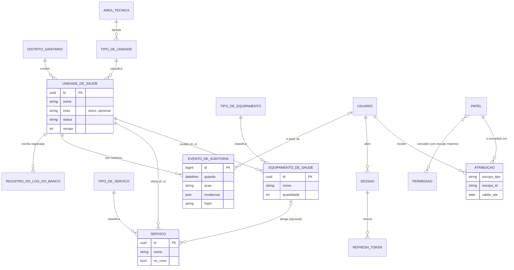

# Modelo conceitual (entidade-relacionamento)

Notação de pés de galinha (Mermaid). Atributos principais; o detalhe de cada coluna está no [dicionário](04-dicionario-dados.md).

Regras de cardinalidade e participação:
- Unidade → distrito e unidade → tipo: obrigatórias (1, N).
- Equipamento → unidade: **opcional**. Equipamento sem unidade é a UTI móvel.
- Serviço → unidade: **opcional** (serviço solto). Serviço → equipamento: opcional, e precisa ser da mesma unidade.
- Papel × permissão: N:N com atributo (escopo máximo). Usuário × papel: N:N com atributos (escopo, validade, origem), materializado em `ATRIBUICAO`.
- Evento de auditoria: entidade fraca da trilha, encadeada pelo hash do evento anterior.
