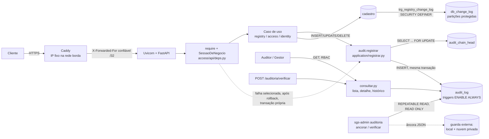

# Ferramentas do Audit Trail do SGS Recife

**Disciplina:** Segurança e Auditoria em Sistemas da Informação · **Projeto:** SGS Recife (API FastAPI da Plataforma de Governança de Dados de Saúde) · **Escopo:** trilha de auditoria depois da spec 013 (tarefas T1 a T15) · **Data:** 11/11/2026

Este relatório descreve a implementação **como ela está no código** (branch `feat/013-trilha-auditoria`). As afirmações apontam arquivos e testes. As que dependem de procedimento humano ou ficam fora do escopo estão marcadas como tal.

## 1. Contexto

### 1.1 Objetivo
O SGS centraliza o cadastro da rede de saúde do Recife: unidades, equipamentos, serviços e referências. A trilha de auditoria responde, para cada operação relevante:
- **quem** fez (pessoa, sistema, seed ou comando administrativo);
- **o quê** (ação e mudanças `{campo, de, para}`);
- **quando** (UTC, com microssegundos);
- **de onde** (IP da conexão confiável e User-Agent declarado);
- **com que resultado** (sucesso, falha ou negação).

Ela também permite **detectar** adulterações e **recuperar** o banco conferindo a integridade.

### 1.2 Problemas tratados
Uma auditoria técnica encontrou nove lacunas, de A a I, na trilha original (spec 001 e spec 008):

| Lacuna | Problema |
|---|---|
| A | Eventos de sistema sem origem |
| B | Horário sem segundos e sem fuso |
| C | IP aceito de qualquer proxy (`--forwarded-allow-ips "*"`) e User-Agent só nos eventos de login |
| D | Sem campo de resultado, e as falhas de negócio sumiam no rollback |
| E | A verificação não detectava a remoção do fim da cadeia |
| F | O log do banco (`db_change_log`) podia ser alterado pelo dono |
| G | Sem teste sistemático de cobertura |
| H | A tela sem detalhe do evento |
| I | Retenção e backup só no papel |

A spec 013 (`specs/013-trilha-auditoria-reforco/`) tratou cada uma, com requisitos em EARS, design, 15 tarefas e uma matriz requisito → tarefa → teste.

### 1.3 Requisitos atendidos
| Propriedade | Como |
|---|---|
| Integridade | Cadeia SHA-256; tabelas só de inserção; verificação com cabeça e âncora |
| Rastreabilidade | Todo evento novo com ação, entidade, tipo de ator, origem, resultado, IP e User-Agent; teste de cobertura das 26 rotas de escrita |
| Responsabilização | Ator humano distinguido de sistema, seed, CLI e anônimo, sem usuário inventado |
| Controle de acesso | RBAC: trilha só com `auditoria:read` global; IP, User-Agent e sessão só com `auditoria:read_acessos` |
| Recuperação | Backup e restauração documentados, com ensaio automatizado e evidência |

### 1.4 Relação com a disciplina
O trabalho aplica:
- **controles de detecção** (hash encadeado, âncora externa);
- **controles preventivos** (triggers, `REVOKE`, privilégio mínimo, proxy confiável);
- **controle de acesso** baseado em papéis com minimização de dados pessoais (LGPD);
- **gestão de evidências** e um **modelo de ameaças** explícito, que separa o que a solução previne do que ela só detecta.

## 2. Inventário das ferramentas

### 2.1 Serviços e ferramentas de execução
| Item | Versão no projeto | Função no Audit Trail |
|---|---|---|
| **PostgreSQL** | 17 (`docker/compose.yml`, Testcontainers) | Guarda `audit_log`, `audit_chain_head` e `db_change_log`. Fornece transações, isolamento `REPEATABLE READ`, triggers, views, partições, `pg_dump` e `pg_restore` |
| **Docker / Docker Compose** | Compose v2 | Ambiente da API, do banco e do proxy. As redes `borda` (proxy e API) e `dados` (API e banco) isolam quem pode falar com a API (`docker/compose.yml`) |
| **Caddy** | imagem `caddy:2` (v2.11.9 no ambiente verificado) | Proxy TLS na frente da API. Sem `trusted_proxies`, descarta o `X-Forwarded-For` enviado pelo cliente e escreve o IP da conexão (`docker/caddy/Caddyfile`) |
| **Uvicorn** | 0.54.0 | Servidor ASGI. O `ProxyHeadersMiddleware` só aceita `X-Forwarded-For` do IP fixo do Caddy (`FORWARDED_ALLOW_IPS=<ip>/32`, `docker/Dockerfile`) |

### 2.2 Linguagem, bibliotecas e frameworks
| Item | Versão | Função |
|---|---|---|
| **Python** | 3.13 | Linguagem da API e das ferramentas |
| **FastAPI** | 0.142.2 | Rotas, dependências (`require()`, `SessaoDeNegocio`), schemas de saída e contrato OpenAPI (`contracts/openapi.yaml`) |
| **Pydantic** | 2.13 | Validação de entrada (por exemplo, `AncoraIn` com `^[0-9a-f]{64}$`) e saída (`EventoOut`, `EventoDetalheOut`, `VerificacaoOut`) |
| **SQLAlchemy** (asyncio) + **asyncpg** | 2.1.3 / 0.31 | Sessões e transações assíncronas; SQL escrito à mão em arquivos `.sql` (ADR-0009) |
| **Alembic** | 1.20.0 | Versionamento do esquema: migrações `0013_01` a `0013_04`, cada uma com SQL documentado em `migrations/sql/<revisão>/` |
| **hashlib** (biblioteca padrão) | — | SHA-256 do conteúdo canônico (`src/modules/audit/domain/entry.py`) |
| **structlog** | 26.1 | Log técnico JSON. Registra `auditoria_falha_nao_registrada` sem valores sensíveis |
| **pytest** + **Testcontainers** | 9.1 / 4.15 | Testes contra PostgreSQL real e descartável, inclusive o ensaio de restauração com dois servidores |
| **Playwright** (Python) | — | Testes da tela (detalhe, resultado, horário, verificação com âncora) num stack Compose descartável (ADR-0011) |

### 2.3 Mecanismos nativos do PostgreSQL usados
- **Triggers `BEFORE UPDATE/DELETE` (linha) e `BEFORE TRUNCATE` (comando):**
  - no `audit_log` (`audit_log_somente_insercao`, migração 0001);
  - no `db_change_log`, na mãe e em cada partição (`db_change_log_somente_insercao`, 0013_03).
- **`ENABLE ALWAYS`:** os triggers atuam também com `session_replication_role = replica` (0013_03).
- **Função `SECURITY DEFINER`:** `trg_registry_change_log` grava o log do cadastro com o privilégio do `sgs_owner` (0011_07).
- **`CHECK … NOT VALID`:** `ck_audit_log_origem_obrigatoria` exige tipo e resultado nos eventos novos sem invalidar os antigos (0013_02).
- **`UNIQUE (prev_hash)` e `SELECT … FOR UPDATE` em `audit_chain_head`:** impedem a bifurcação da cadeia e serializam as gravações.
- **`SET TRANSACTION ISOLATION LEVEL REPEATABLE READ, READ ONLY`:** foto única para a verificação (`audit_snapshot_consistente.sql`).
- **View com `security_invoker`:** `vw_unit_history` (0013_04).
- **Particionamento por intervalo** e procedimento com cursor (`sp_ensure_monthly_partitions`).
- **`REVOKE` e papéis:** `sgs_app` só faz INSERT e SELECT na trilha e só SELECT no log do banco.

### 2.4 Componentes desenvolvidos no projeto
| Componente | Onde |
|---|---|
| Registro e encadeamento (`registrar`, `registrar_falha`, `AuditEntry`) | `src/modules/audit/application/registrar.py`, `domain/entry.py` |
| Metadata de falha em lista fechada | `src/modules/audit/domain/falha.py` |
| Verificação, âncora e detalhe com RBAC | `src/modules/audit/application/consultar.py` |
| Origem da requisição (IP, User-Agent) | `src/core/origem.py` |
| Classificação de falhas de negócio | `src/modules/access/api/deps.py` (`_sessao_de_negocio`) |
| CLI `sgs-admin auditoria ancorar` e `verificar` | `src/tools/sgs_admin.py` |
| Telas `#/historico` e `#/cadeia` | `frontend/app/js/views/historico.js` |

## 3. Justificativa das escolhas

| Escolha | Alternativa avaliada | Por que a escolha serve ao SGS |
|---|---|---|
| **PostgreSQL** | MySQL; MongoDB | Já era o banco do projeto. O que a trilha precisa é nativo e documentado: triggers de comando para TRUNCATE, `ENABLE ALWAYS`, `CHECK NOT VALID`, `REPEATABLE READ` com foto única, view `security_invoker` e `SECURITY DEFINER`. Num banco de documentos, a imutabilidade e a foto consistente ficariam por conta da aplicação |
| **SHA-256 encadeado** | SHA-3; HMAC | O SHA-256 (FIPS 180-4) está na biblioteca padrão e basta para detectar alteração do conteúdo canônico. O SHA-3 não muda o modelo de ameaça. O HMAC daria autenticidade, mas exige gerar, guardar, girar e recuperar uma chave, e quem tem o banco e a chave reescreve tudo do mesmo jeito. Ficou como trabalho futuro (ADR-0012) |
| **Triggers no banco + registro na aplicação** | Auditoria só na aplicação | A aplicação grava o evento de negócio com contexto (ator, rota, resultado) na mesma transação. O banco garante o que a aplicação não consegue: recusar UPDATE, DELETE e TRUNCATE até do dono, e registrar no `db_change_log` alterações feitas **fora** da API |
| **Alembic com SQL explícito** | Migrações SQL manuais | O Alembic versiona e encadeia as revisões. O SQL em arquivo, com cabeçalho de objetivo, justificativa e requisito (verificado por `tests/architecture/test_sql_documentado.py`), deixa cada objeto auditável |
| **CLI própria (`sgs-admin`)** | Ferramenta externa de auditoria | Reaproveita o mesmo `verificar_cadeia` da API, sem uma segunda implementação. Roda direto no banco, sem a API, e serve para verificar uma cópia restaurada sem confiar no servidor de produção |
| **Testcontainers** | Banco de teste compartilhado | Cada teste usa um PostgreSQL real e descartável. As adulterações como superusuário e o ensaio de restauração não tocam ambientes existentes |
| **Proxy confiável `/32`** | Confiar na subnet ou em `*` | A subnet inclui o gateway da bridge, e `*` deixaria qualquer contêiner escolher o IP gravado. O `/32` do IP fixo do Caddy é o mínimo necessário |

Critério comum: integração com a stack existente, baixo custo operacional, testabilidade e proporção ao escopo acadêmico. Nenhuma dessas tecnologias é tratada como superior em geral.

## 4. Benefícios

### 4.1 Comprovados por implementação e teste
| Benefício | Evidência |
|---|---|
| Hashes históricos preservados com os campos novos | `tests/unit/audit/test_hash.py::test_hash_de_registro_v1_nao_muda` |
| Detecção de alteração, remoção no meio, no fim e do primeiro evento | `tests/integration/audit/test_adulteracao.py` |
| Verificação sem falso positivo com escrita concorrente | `test_adulteracao.py::test_escrita_concorrente_nao_gera_falso_positivo`. Sem o `REPEATABLE READ`, o mesmo cenário deu `integra=false`: prova negativa da T8 |
| Âncora acusa reescrita mesmo com a cabeça ajustada | `test_adulteracao.py::test_delete_no_fim_com_cabeca_ajustada_so_a_ancora_acusa` |
| Imutabilidade do log do banco, também em modo `replica` | `tests/integration/audit/test_log_banco_privilegios.py` |
| Tipo de ator e origem corretos, sem usuário inventado | `tests/integration/audit/test_origem.py` |
| IP não falsificável por cabeçalho | `tests/unit/core/test_origem.py`; `tests/e2e/test_auditoria_proxy.py` (Caddy, contêiner vizinho, gateway) |
| Falhas registradas sem dados enviados e sem esconder o erro | `tests/integration/audit/test_falhas_auditadas.py` |
| Cobertura das 26 rotas de escrita | `tests/integration/audit/test_cobertura_rotas.py` |
| Dados de origem só para o Auditor, por qualquer rota GET | `tests/integration/audit/test_privacidade_trilha.py` |
| Verificação offline por CLI, só de leitura | `tests/integration/tools/test_sgs_admin_verificar.py`, `test_sgs_admin_ancorar.py` |
| Restauração preservando cadeia, âncora, constraint `NOT VALID`, triggers e privilégios | `tests/integration/audit/test_backup_restauracao.py`; `docs/operacao/evidencias/ensaio-restauracao-2026-11-11.json` |

### 4.2 Potenciais, que dependem de operação
- **Evidência independente da âncora:** depende de ela ser guardada fora do banco, nas duas cópias previstas.
- **RPO e RTO:** dependem da disciplina do backup diário. O ensaio mediu segundos num banco pequeno; não é medida de produção.
- **Evolução:** o desenho em camadas e a matriz de cobertura permitem acrescentar eventos sem reescrever a trilha.

## 5. Limitações e riscos residuais
1. **Detecção, não prevenção, contra o administrador.** O dono ou o superusuário ainda podem desligar trigger com DDL, desanexar ou apagar partição e reescrever a cadeia e a cabeça. `ENABLE ALWAYS` só fecha o desvio por `session_replication_role` (`test_limite_dono_consegue_detach_drop_e_disable_trigger`).
2. **SHA-256 não autentica.** Sem chave, o hash prova coerência, não autoria. Uma reescrita completa e coerente depois da última âncora não é detectável.
3. **Inserção pela aplicação comprometida.** O `sgs_app` pode inserir eventos falsos corretamente encadeados.
4. **Sem segregação de funções.** O proprietário é o único responsável pelo banco, pelos backups e pelas âncoras, então âncora e banco ficam sob o mesmo controle administrativo. É risco aceito (spec 013 P6; risco R13 em `docs/governanca/03-registro-de-riscos.md`).
5. **Dependência de procedimento humano.** Não há agendador de backup nem de âncora. Um esquecimento aumenta a janela de perda.
6. **Disponibilidade.** Não há réplica nem recuperação ponto a ponto (WAL). A recuperação é pelo último backup.
7. **Origem das requisições.** O User-Agent é declarado pelo cliente. O IP é dado de rede e não identifica a pessoa. Um balanceador antes do Caddy, em produção, ficaria fora do modelo (spec 013 P3).
8. **Log do banco.** Linhas apagadas pelo dono com o trigger desligado não deixam rastro no próprio log. Uma partição removida aparece como um mês faltando na lista de partições.
9. **Ambiente acadêmico.** Falta, por estar fora do escopo: `pgaudit`, log do servidor PostgreSQL, guarda das âncoras em destino só de acréscimo e carimbo de tempo de terceiro.

## 6. Arquitetura e fluxo



1. **A operação chega.** Uma requisição passa pelo Caddy e pelo Uvicorn. `require()` confere a permissão; se negar, `acesso.negado` é gravado numa transação própria. A `SessaoDeNegocio` abre a transação de negócio.
2. **O evento é construído.** O caso de uso monta um `Ator` (`ator_da_requisicao`: tipo `usuario`, origem `api`, IP e User-Agent de `src/core/origem.py`), a entidade, as mudanças e o resultado.
3. **O hash é calculado.** `registrar` trava `audit_chain_head` (`FOR UPDATE`), calcula `hash = SHA-256(prev_hash || JSON canônico)` e insere o evento, com os campos da 013 entrando no JSON só quando não são nulos.
4. **A cabeça é atualizada.** `audit_chain_head.last_hash` recebe o hash novo, na mesma transação da alteração de negócio.
5. **Falhas.** Uma falha selecionada (409, 412, 428, 422 de domínio, 500) desfaz a operação. Depois, `operacao.falhou` é gravado numa transação nova; se essa gravação falhar, o erro original sai do mesmo jeito.
6. **Consulta.** Lista, histórico da unidade (`vw_unit_history`) e detalhe aplicam o RBAC. O detalhe esconde IP, User-Agent e sessão sem `read_acessos` e grava `auditoria.evento_consultado`.
7. **Verificação.** A verificação (API ou CLI) recalcula a cadeia numa foto `REPEATABLE READ, READ ONLY` e compara o fim com a cabeça. A API grava `auditoria.verificada` numa transação separada; a CLI não grava nada.
8. **Âncora.** A âncora externa (`cadeia_id`, `id`, `hash`) confirma que a cadeia é a mesma e que o evento ancorado não mudou.
9. **Restauração.** `pg_dump -Fc` e `pg_restore` preservam dados, constraint `NOT VALID`, triggers e privilégios. A conferência é feita com a CLI e a âncora anterior ao backup.

## 7. Organização do código e roteiro de demonstração

O Audit Trail é um módulo próprio do monólito modular (ADR-0002), com as camadas verificadas pelo import-linter (`pyproject.toml`, contratos `camadas-dos-modulos` e `dominio-puro`):

```
src/modules/audit/
├── domain/           regras puras, sem framework
│   ├── entry.py      AuditEntry, Ator, conteúdo canônico e SHA-256; tipos de ator e resultados
│   ├── falha.py      metadata do operacao.falhou em lista fechada
│   ├── consultas.py  Evento, ResultadoDaVerificacao, Ancora, IdentidadeDaCadeia
│   └── ports.py      portas AuditStore e ConsultasDeAuditoria
├── application/      casos de uso
│   ├── registrar.py  registrar, registrar_falha (o que os outros módulos chamam)
│   └── consultar.py  verificar_cadeia, gerar_ancora, detalhar_evento (RBAC), listagens
├── infrastructure/   PostgreSQL
│   ├── repository.py SqlAuditStore (trava da cabeça, INSERT)
│   ├── consultas.py  SqlConsultasDeAuditoria
│   ├── tables.py     audit_log, audit_chain_head, db_change_log (metadata)
│   └── sql/          consultas escritas à mão (lote da cadeia, cabeça, foto consistente…)
└── api/              rotas /api/v1/auditoria/* e schemas (EventoOut, VerificacaoOut…)
```

**Integrações fora do módulo.** Cada módulo grava os próprios eventos chamando `audit.application.registrar` dentro da sua transação, como determina a spec 001:

| Onde | O quê |
|---|---|
| `src/core/origem.py` | IP e User-Agent da requisição |
| `src/modules/access/api/deps.py` | `ator_da_requisicao`, `acesso.negado` e `operacao.falhou` (classificação das falhas) |
| `src/modules/access/application/autorizacao.py` | `auditar_negacao` |
| `src/modules/identity/application/login.py` | eventos `auth.*` |
| `src/modules/registry/application/*.py` | eventos de unidade, equipamento, serviço e referência |
| `src/tools/sgs_admin.py` | CLI (`auditoria ancorar` e `verificar`) e eventos do `create-user` |
| `migrations/versions/0001_base.py`; `migrations/sql/0011_07`, `0011_08`, `0013_01`…`0013_04` | triggers, constraints, view, procedimento |
| `frontend/app/js/views/historico.js`, `views/unidade.js` | telas |

Essa distribuição segue o desenho: o evento nasce onde está o contexto de negócio. Mover esses pontos para dentro do módulo de auditoria o acoplaria a todos os outros. Não houve reorganização.

**Roteiro de demonstração**, cerca de 10 minutos:
1. **Geração:** `registry/application/unidades.py`, chamada a `registrar` em `criar_unidade`.
2. **Regras e hash:** `audit/domain/entry.py`, `content()` e `recompute_hash()`.
3. **Persistência e cabeça:** `audit/infrastructure/repository.py` e `migrations/sql/0013_03/` (`ENABLE ALWAYS`).
4. **Verificação:** `audit/application/consultar.py`, `verificar_cadeia` (foto `REPEATABLE READ`, cabeça, âncora).
5. **Âncora e CLI:** `src/tools/sgs_admin.py`, `ancorar_cadeia` e `verificar_offline`.
6. **Autorização:** `detalhar_evento` (origem só com `read_acessos`) e `access/api/deps.py` (falhas).
7. **Prova:**
   - `uv run pytest tests/integration/audit/test_adulteracao.py`;
   - na tela, `#/cadeia` com a âncora;
   - o ensaio `tests/integration/audit/test_backup_restauracao.py` e a evidência em `docs/operacao/evidencias/`.

## 8. Conclusão
As ferramentas atendem aos requisitos acadêmicos e técnicos da spec 013, com evidência automatizada para cada um. O `make check` passa com mais de mil testes, e os testes lentos (proxy, tela, restauração) rodam à parte em ambientes descartáveis.

As escolhas mais relevantes para a integridade foram:
- o **encadeamento SHA-256 com conteúdo canônico estável**;
- a **imutabilidade imposta pelo próprio PostgreSQL** (triggers `ENABLE ALWAYS`, `REVOKE`);
- a **verificação em foto consistente com cabeça e âncora externa**.

Para a rastreabilidade, as mais relevantes foram o **tipo de ator e resultado obrigatórios** e o **proxy confiável `/32`**.

Continuam valendo os limites da seção 5:
- detecção, e não prevenção, contra quem administra o banco;
- ausência de autenticação criptográfica;
- responsável único;
- operação manual.

Evoluções naturais, cada uma com spec própria:
- âncora publicada automaticamente num destino só de acréscimo, com carimbo de tempo de terceiro (RFC 3161);
- HMAC com gestão de chaves;
- `pgaudit` e log do servidor para ações administrativas;
- backup contínuo (WAL/PITR);
- separação entre quem administra o banco e quem guarda as âncoras.

## 9. Referências
- PostgreSQL 17, CREATE TRIGGER: https://www.postgresql.org/docs/17/sql-createtrigger.html
- PostgreSQL 17, ALTER TABLE (`ENABLE ALWAYS TRIGGER`, `NOT VALID`, `DETACH PARTITION`): https://www.postgresql.org/docs/17/sql-altertable.html
- PostgreSQL 17, `session_replication_role`: https://www.postgresql.org/docs/17/runtime-config-client.html
- PostgreSQL 17, isolamento de transações: https://www.postgresql.org/docs/17/transaction-iso.html
- PostgreSQL 17, CREATE FUNCTION (`SECURITY DEFINER`): https://www.postgresql.org/docs/17/sql-createfunction.html
- PostgreSQL 17, CREATE VIEW (`security_invoker`): https://www.postgresql.org/docs/17/sql-createview.html
- PostgreSQL 17, particionamento: https://www.postgresql.org/docs/17/ddl-partitioning.html
- PostgreSQL 17, pg_dump, pg_restore e pg_dumpall: https://www.postgresql.org/docs/17/app-pgdump.html, https://www.postgresql.org/docs/17/app-pgrestore.html, https://www.postgresql.org/docs/17/app-pg-dumpall.html
- NIST FIPS 180-4, Secure Hash Standard: https://csrc.nist.gov/pubs/fips/180-4/upd1/final
- Python, `hashlib`: https://docs.python.org/3/library/hashlib.html
- FastAPI, dependências com `yield`: https://fastapi.tiangolo.com/tutorial/dependencies/dependencies-with-yield/
- SQLAlchemy, níveis de isolamento: https://docs.sqlalchemy.org/en/20/orm/session_transaction.html
- Alembic: https://alembic.sqlalchemy.org/
- Uvicorn, proxies e `forwarded_allow_ips`: https://www.uvicorn.org/settings/
- Caddy, `reverse_proxy` e cabeçalhos repassados: https://caddyserver.com/docs/caddyfile/directives/reverse_proxy
- Docker, redes: https://docs.docker.com/engine/network/
- pytest: https://docs.pytest.org/
- Testcontainers para Python: https://testcontainers-python.readthedocs.io/
- Lei 13.709/2018 (LGPD): https://www.planalto.gov.br/ccivil_03/_ato2015-2018/2018/lei/l13709.htm
